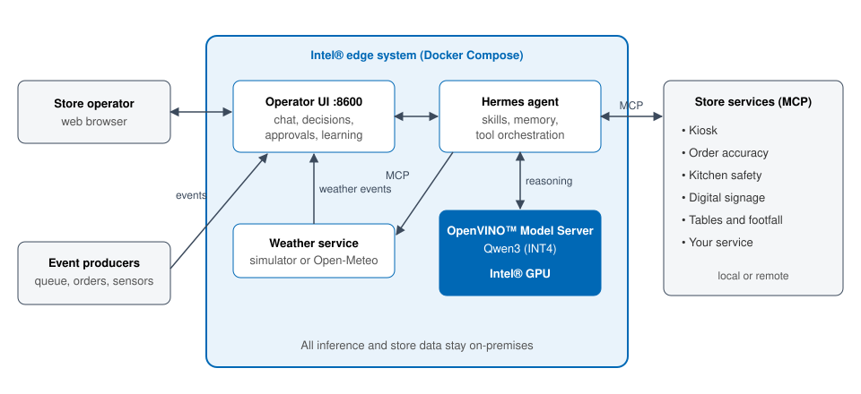

# QSR Store Agent

An AI operations assistant for quick-service restaurants that runs entirely on
an Intel® edge system. Store staff ask questions in plain language and get
answers from live store data. The agent also reacts to store events with
recommendations that a manager approves before anything changes.

The language model runs locally with the OpenVINO™ Model Server on an Intel®
GPU, so store data never leaves the premises.



## Quick Start

Requires Linux, an Intel® GPU, and Docker. See
[System Requirements](docs/user-guide/get-started/system-requirements.md).
Store data comes from store services on their own hosts
([Connect Store Services](docs/user-guide/get-started/configuration.md#connect-store-services)).

```bash
git clone https://github.com/intel-retail/qsr-agent.git
cd qsr-agent
make download-models
# Edit .env.example (make up copies it to .env) and set the store service URLs,
# for example QSR_KIOSK_MCP_URL=http://<kiosk-host>:<port>/mcp
make up
```

Open `http://<host>:8600` when `make status` shows `qsr-agent` as `healthy`.
To run the code you cloned rather than the published image, use
`make up REGISTRY=false` ([Build from Source](docs/user-guide/get-started/build-from-source.md)).

```bash
make weather CONDITION=rain TEMP=12   # send a demo event
make logs                             # follow logs
make down                             # stop
```

## Documentation

- [Overview](docs/user-guide/index.md)
- [Get Started](docs/user-guide/get-started.md)
  - [System Requirements](docs/user-guide/get-started/system-requirements.md)
  - [Configuration](docs/user-guide/get-started/configuration.md)
  - [Build from Source](docs/user-guide/get-started/build-from-source.md)
- [How It Works](docs/user-guide/how-it-works.md)
- [Operator Guide](docs/user-guide/operator-guide.md)
- [API Reference](docs/user-guide/api-reference.md)
- [Troubleshooting](docs/user-guide/troubleshooting.md)
- [Release Notes](docs/user-guide/release-notes.md)

Earlier developer and design documents are kept in [docs/backup](docs/backup/).

## Security and Contributing

See [SECURITY.md](SECURITY.md) to report a vulnerability and
[CONTRIBUTING.md](CONTRIBUTING.md) to contribute.
