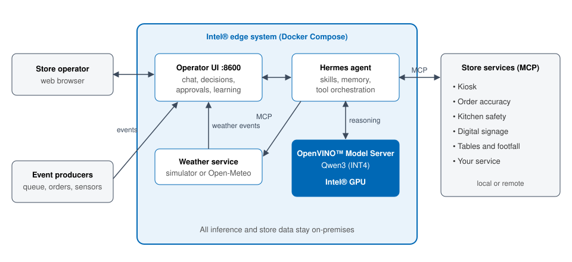

# How It Works



## Components

| Component | Role |
|---|---|
| Operator UI | Web interface for chat, connected-service status, decisions, approvals, and learning. Also receives events from store systems. |
| Agent runtime (Hermes) | Understands the request, picks the relevant store skills, calls store services, and composes the answer. Keeps operator preferences in memory. |
| OpenVINO™ Model Server | Serves the Qwen3 INT4 language model set by `MODEL_ID` on the Intel® GPU through an OpenAI-compatible API. |
| Skills | Short procedures, one per store domain, that tell the agent which service and fields answer which question. |
| Learner | Turns recorded operator actions into a learned skill per service. Each rule is checked against the records, and an operator approves the skill. |
| Store services (MCP) | Own the store data and actions, and send the store events, for example kiosk queue changes or weather changes. Each service validates its own actions and enforces its own policy. Services run on their own hosts or share one; the agent and its model run on a separate machine. |

The agent never holds store data itself. It reads data from the services at
the moment of the question, so answers reflect the current state of the store.

## Answering a Question

1. The operator asks a question in the UI.
2. A scope check declines questions that are unrelated to the store.
3. The agent loads the matching skill, for example `kiosk-operations` for a
   queue question.
4. The language model chooses which service tools to call.
5. The services return live data.
6. The model writes the answer using only the returned data. If a service is
   unavailable, the answer says so instead of guessing.

## Responding to an Event

```text
Store event -> queue -> agent gathers context -> no action  (reason shown)
                                              -> proposal   -> operator approves -> service applies it
                                                                                 -> operator rejects
```

1. A store system posts an event, such as `weather_changed`,
   `queue_count_changed`, or `order_mismatch_detected`.
2. The event is saved and queued. Events are processed one at a time in arrival
   order, and they survive restarts. Duplicate event IDs are ignored.
3. The agent selects relevant skills and reads live context from the services,
   such as queue, staffing, menu, and weather.
4. The agent either explains why no action is needed, or proposes a specific
   action, such as hiding a slow-to-prepare menu item while the queue is long.
5. The proposal appears in **Autonomy Decisions**. It expires after five
   minutes if nobody acts on it.
6. On approval, the owning service validates and applies the action.

Order-accuracy remakes are operator-led until the agent has learned when to
propose them: while the event is shown, tell the agent in chat to remake the
order. Take-away and dine-in are separate MCP servers, so the agent sends the
remake to the one named in the event's `data.venue`.

There is no fixed rule such as "rain means add hot drinks". The agent decides
from the current context, and the operator stays in control.

## Learning From Operators

When an event is shown, the operator can approve or reject the proposal, give a
reason, or tell the agent in chat what to do instead. These responses are
recorded. After enough responses for a service, the operator can start
learning. The agent drafts new guidance for that kind of event, the guidance is
checked against the recorded history, and the operator reviews it before it
takes effect. Approved guidance is used for future events from that service.

All services share one learning journal. Each record holds the event (with
its service), the live context the agent read, what the agent proposed, and
what the operator did. Records are added live from:

- **Chat**: an instruction typed while the event banner is shown, with the
  action tools Hermes called (local or remote services).
- **Approvals and rejections** in the console, with the optional reason.
- **Silence**: events nobody responded to within the link window.
- **The service itself**: `POST /learning/responses`, for actions taken on the
  service's own screen.

Events without a `service` field are assigned one from their type (for
example `order_mismatch` → `accuracy`). Add more mappings with
`QSR_EVENT_SERVICES=table_dirty=table`.

Examples of what can be learned (from `learning/simulated/event_op_response.jsonl`):

| Service | Event | Learned rule (example) |
|---|---|---|
| Kiosk | `queue_count_changed` | Queue ≥ 10 in standard mode → express; wait ≥ 8 min → open a kiosk; queue ≥ 8 → upsell off; short twice → back to normal |
| Weather | `weather_changed` | Raining and hot drinks off → hot drinks on; rain stops → hot drinks off; ≥ 29 °C → shake on |
| Order accuracy | `order_mismatch_detected` | Missing item at the pickup counter with confidence ≥ 0.9 → remake that order (order id taken from the event) |

Rules can test list items by id (for example whether `tea` is already on the
menu) and copy an event value into an argument (for example the order id).

### Adding a Service (Plug and Play)

Any MCP server in the Hermes `mcp_servers` configuration is picked up
without agent code changes. Servers that are offline are retried about once
a minute, so a service can start before or after the agent.

1. **Journal, right away**: chat action calls on the server, and
   `POST /learning/responses` calls naming `<service>.<tool>`, are recorded.
   The service name is the server name (lowercase, `-` for other characters).
2. **Event decisions and learning**: the server's tools join the autonomy
   catalog. Tools with the MCP `readOnlyHint` annotation, or named `get_`,
   `list_`, `read_`, `search_` and similar, are reads. Others are actions.
   Actions are only proposed when the server has a read with no required
   arguments, which the agent reads as live context first. Every proposal
   is checked against the tool's input schema and needs operator approval.

The service should send its events with `"service": "<server name>"` (or map
the event type with `QSR_EVENT_SERVICES`). Tools listed in
`QSR_AUTONOMY_DISABLED_TOOLS` are not added. The `order-accuracy-take-away` and
`order-accuracy-dine-in` servers are journaled and learned as one `accuracy`
service.

## Stored Data

All state is kept in Docker volumes on the edge system:

| Volume | Contents |
|---|---|
| `autonomy-state` | Event queue, decisions, and approvals |
| `learning` | Operator response history, learned guidance, and agent memory |
| `weather-state` | Current simulated weather |

`make down` keeps the volumes. To remove all data as well, run
`docker compose down -v`.

## Trust and Safety

- **Local inference:** prompts and store data are processed on the edge system
  and are not sent to a cloud model.
- **Approval required:** event-driven actions run only after an operator
  approves them.
- **Service-owned policy:** each store service validates its own actions,
  independently of the agent.
- **Grounded answers:** the agent is instructed to answer only from service
  data and to report missing coverage.
- **Scope limits:** off-topic questions are declined before a full model turn.
